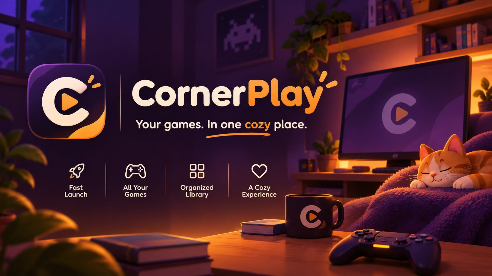
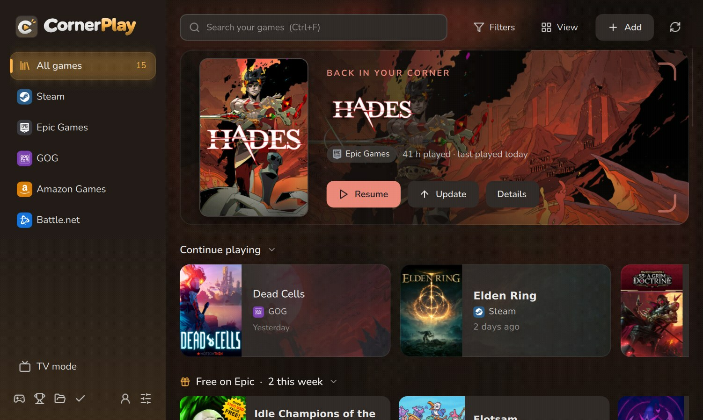
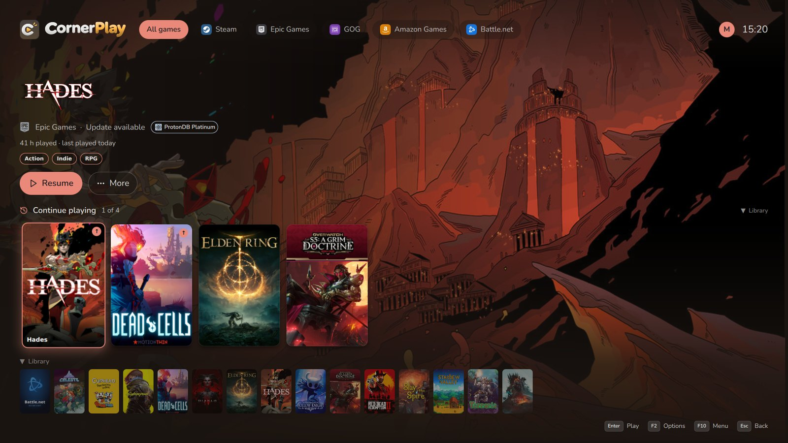
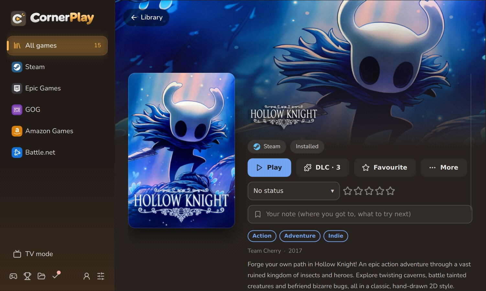
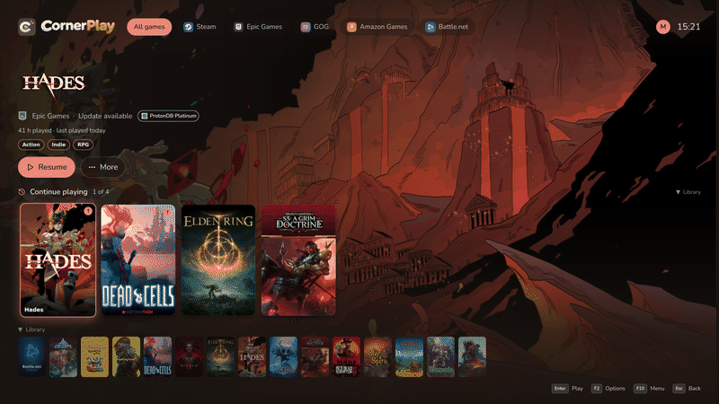

  <b>Steam, Epic Games, GOG, Amazon Games and Battle.net in one cosy library on Linux, 
  with a couch-friendly TV mode for your controller.</b>

  <a href="https://github.com/raulgbh-ctrl/cornerplay/releases/latest"><b>Download</b></a> ·
  <a href="#quick-start">Quick start</a> ·
  <a href="#setting-up-each-store">Store setup</a> ·
  <a href="#requirements">Requirements</a> ·
  <a href="#all-the-features">Features</a>

<table>
  <tr>
    <td width="50%"></td>
    <td width="50%"></td>
  </tr>
  <tr>
    <td align="center">TV mode: big covers, the game's own art, controller first</td>
    <td align="center">A game's page: Play, DLC, your notes and rating</td>
  </tr>
</table>

Pull up a chair. Cornerplay gathers every game you own into one warm, quiet place, so the
one you want is always right there: covers that keep up with the stores, the game you played
last waiting up front, a TV mode laid out like SteamOS Game Mode, and Proton sorted out behind
the scenes. No more hopping between five launchers to find something to play tonight.

*Formerly AIO Launch (and before that, Kura): settings, sign-ins and games come along by
themselves, and the old `aiolaunch` command keeps working.*

## Quick start

1. **Install.** Download `cornerplay.run` from the
   [latest release](https://github.com/raulgbh-ctrl/cornerplay/releases/latest) and run it:

       curl -fLO https://github.com/raulgbh-ctrl/cornerplay/releases/latest/download/cornerplay.run && sh cornerplay.run

   **Arch / CachyOS / Manjaro** can install it as a package instead (an AUR upload is coming):

       git clone https://github.com/raulgbh-ctrl/cornerplay && cd cornerplay/packaging/aur && makepkg -si

   No root needed for Cornerplay itself. It adds itself to your app menu and fetches what games
   need (it asks before installing Steam through your package manager or Flathub).
2. **Connect a store.** Open Cornerplay, click the person icon at the bottom of the sidebar
   (**Accounts**) and sign in to a store. Steam needs no sign-in: if the Steam client is
   installed and you are signed in there, your games show up by themselves.
3. **Play.** Double-click a cover (or select it and press Enter). Not installed yet? Its page has
   an Install button; Proton is chosen and set up for you. Press **F11** (or the Guide button on
   a controller) for TV mode.

## Setting up each store

| Store | How to connect | Needed? |
|-------|----------------|---------|
| **Steam** | Nothing: Cornerplay reads the Steam client on this PC. Games install and start through Steam. | The Steam client (the installer offers it). |
| **Epic Games** | Accounts > Epic Games > Sign in: a sign-in window opens; Cornerplay keeps the session through [legendary](https://github.com/derrod/legendary). | Nothing else. |
| **GOG** | Accounts > GOG > Sign in. Installs go through [gogdl](https://github.com/Heroic-Games-Launcher/heroic-gogdl); Linux versions are used when a game has one. | Nothing else. |
| **Amazon Games** | Accounts > Amazon Games > Sign in, through [nile](https://github.com/imLinguin/nile). | Nothing else. |
| **Battle.net** | See below. | The Battle.net app, under Proton. |

**Steam Web API key (optional).** Without one, Cornerplay lists the Steam games in your Steam
client's library. With one it also lists every game you own (even ones Steam has never shown on
this PC) and shows achievement progress. Get a key at
[steamcommunity.com/dev/apikey](https://steamcommunity.com/dev/apikey) (any domain name works, e.g.
`localhost`) and paste it in **Settings > Library**. If the list or achievements stay empty, set your
Steam profile's *Game details* to Public.

**SteamGridDB key (optional).** Cornerplay finds covers on its own (store art, Steam's store,
IGDB). A free [SteamGridDB](https://www.steamgriddb.com) key adds art for games Steam doesn't sell,
better wide banners and animated covers in TV mode: sign in there, open
[Preferences > API](https://www.steamgriddb.com/profile/preferences/api), generate a key and paste
it in **Settings > Library**.

**Battle.net under Proton.** Blizzard has no API for other launchers, so Cornerplay runs
Blizzard's own app:

1. In the library, the **Battle.net** tile is the app itself. Press Install: Cornerplay downloads
   Blizzard's installer and runs it in its own Proton prefix.
2. Press Play on the tile and sign in inside the Battle.net app. Install your games there.
3. Back in Cornerplay, each installed game appears as its own tile and starts straight into the
   game. To also see Blizzard games you own but haven't installed, use
   **Accounts > Battle.net > Link account**.

If the Battle.net app closes as soon as it opens, your GPU has no Vulkan driver: the
**Health check** in the sidebar says which package to install (for Intel graphics on Arch:
`vulkan-intel lib32-vulkan-intel`).

## Requirements

- **Linux**, 64-bit. Developed and tested on **CachyOS (Arch)** with Hyprland and KDE Plasma; the
  installer also knows Debian/Ubuntu (apt), Fedora (dnf) and openSUSE (zypper), which have had
  less testing. Steam Deck: works in Desktop Mode and from Game Mode (add it to Steam from
  Settings > Library), lightly tested.
- **Python 3.10+** and **PySide6 (Qt 6.6 or newer)**. If your system has no PySide6, the installer
  sets up a private copy (about 260 MB).
- **A GPU with a Vulkan driver**, for games running through Proton (Epic, GOG, Amazon,
  Battle.net). Steam games use Steam's own setup.
- **Disk space**: Cornerplay itself about 6 MB; each Proton version about 1.5 GB; the cover cache
  grows to a few hundred MB for a large library (about 300 MB for 500 games). Games install to
  `~/Games/cornerplay` by default (changeable in Settings).
- **Steam** for Steam games, and **umu-launcher** for the other stores (the installer fetches
  a copy if your package manager has none). Optional: MangoHud, GameMode.

Files: settings in `~/.config/cornerplay`, the cover cache and logs in `~/.cache/cornerplay`,
games and Proton prefixes in `~/Games/cornerplay`.

To remove it:

    sh ~/.local/lib/cornerplay/install.sh --uninstall   # remove (keeps settings and games)
    sh ~/.local/lib/cornerplay/install.sh --purge       # also remove settings and cache

## Command line

    cornerplay                  # open the library
    cornerplay --tv             # start in full-screen TV mode (F11 switches)
    cornerplay --status         # what each store still needs
    cornerplay --demo           # a sample library; nothing is launched

| Store      | Library from                         | Install / launch through            |
|------------|--------------------------------------|-------------------------------------|
| Steam      | Steam's own cache `appinfo.vdf` (or every owned game with a Web API key) | the Steam client (`steam://` URLs)  |
| Epic       | `legendary list`                     | legendary + Proton (umu-run)        |
| GOG        | GOG web API                          | gogdl + Proton (umu-run), or the Linux version |
| Amazon     | `nile library sync`                  | nile + Proton (umu-run)             |
| Battle.net | the Battle.net app's `product.db`    | the Battle.net app under Proton     |

## All the features

- **Game updates**: Epic, GOG and Amazon games are checked for updates on every refresh. A game with one gets an ↑ badge and an Update button (TV mode: in its actions), and a toast says when a new update is found. Epic compares the installed version with legendary's latest build, GOG compares gogdl's installed build with GOG's newest public build, Amazon asks `nile list-updates`.
- **Playtime**: Epic, GOG and Amazon games are timed while they run (also when started from Steam through `--play`); Steam's own playtime is read from Steam. A game's panel shows hours played and when you last played. "Continue playing" above the library lists your most recent games, and the sort menu orders the library by name, recently played or most played. Battle.net games are not timed (its app stays open after a game closes). Stored in `~/.local/share/cornerplay/playtime.json`.
- **Games hidden in Steam** stay hidden: they go under "Hidden games" (read from Steam's synced collections), and the Steam view leaves them out; a game also owned on another store still shows through that copy. Unhide in Cornerplay to show one anyway (Steam is not changed).
- **Hide games**: Hide on a game's panel (or in TV mode's actions); hidden games live under "Hidden games" in the sidebar, where Unhide brings them back.
- **Games in Steam / Game Mode**: Settings > Library > Add games to Steam puts every installed Epic, GOG, Amazon and Battle.net game into Steam as a non-Steam game, with its cover, banner, background and logo (SteamGridDB if you added a key, otherwise Steam's store art, otherwise the store's own). Each runs through `cornerplay --play`, so Proton settings and cloud saves still apply. "Keep installed games in Steam automatically" adds new installs and removes uninstalled or hidden games whenever Steam is closed. "Add Cornerplay" adds the app itself, opening in TV mode.
- **Merged duplicates**: a game owned on several stores is one tile; its panel asks which launcher to use and remembers it (Settings > Library to turn off).
- **DLC**: the DLC button on a game (with the count once known) lists its DLC with art, whether it is installed or owned, and the price of what you do not own (in your currency). Owned DLC installs from there with progress, one at a time or all at once: Epic through legendary, GOG through gogdl. Steam installs owned DLC by itself and only says which is installed, so the others open in the Steam client to buy or install. Epic lists only the DLC you own.
- **Current covers**: for every game matched to Steam (on any store), Steam's current library capsule comes first; its URL changes whenever the art does (Warframe's new art, seasonal covers), so new art replaces the cached image. Steam's art is checked every 2 days, GOG's every week, Epic's game data every week; covers found by title are looked up again after two weeks. Settings > Library > Refresh artwork now does it at once.
- **Covers and banners**: store art first, then SteamGridDB (API key in Settings > Library), then Steam's store matched by title, then IGDB box art through Lutris's game list (for games Steam does not sell, such as World of Warcraft). Per-game custom cover under Options. Every game also gets backup covers and wide banner art, tried in order when one fails to load: Steam's own asset list for the matching Steam app (Epic, GOG and Amazon games are matched to Steam by title, once, and cached), Steam's local cache, Epic's 16:9 key art, GOG's Galaxy background, and SteamGridDB heroes when a key is set. Cached in `~/.cache/cornerplay` (`steam_assets.json`, `cover_lookup.json`).
- **Look**: games show their own logo (Steam, Epic or GOG logo art, or the title when there is none); the banner, the game panel and TV mode take on the focused game's colour, picked from its cover (`gamecolour.py`, cached); covers shimmer while they load; tiles fade in; installs show a progress strip along the bottom of the cover.
- **Screenshots and trailers**: the game panel shows the game's screenshots (click one to see it full size; arrow keys to browse). In TV mode the focused game's art slowly pans, and after a couple of seconds its trailer plays muted behind the text (Settings > Appearance; needs Qt Multimedia, otherwise it is simply left out; never plays while a game has the focus). Optional soft navigation sounds in TV mode (off by default; synthesised, `cornerplay/sounds/`).
- **Fonts**: [Nunito](https://github.com/googlefonts/nunito), rounded like the logo, for the interface (fixed weights made from the variable font; SIL Open Font Licence, `cornerplay/fonts/OFL-Nunito.txt`), bundled so the app looks the same on every desktop.
- **The look**: the C-and-play-button icon, and a logo that takes its colours from your theme (your wallpaper's colours; `cornerplay/art/brand/`), warm amber as the signature colour (the default "Cornerplay" theme; Follow wallpaper and the other presets are still in Settings > Appearance), store logos on coloured tiles, little scenes for empty screens (drawn in the theme's colours, `qml/EmptyScene.qml`), frosted pop-ups and notifications, a launch card when a game starts (its cover lifts and glows while it gets ready), a short splash while the library loads, and in TV mode a shelf reflection under the covers and an optional start-up animation with a chime. Cover shadows: none, soft or deep. With Follow wallpaper the wallpaper itself sits blurred behind the window, like frosted glass (Settings > Appearance; no compositor blur needed). Covers tilt toward the pointer with a soft light following it; a cover flies into the game page when opened and back when closed; pointing at a cover for a moment plays its trailer inside it (Settings > Appearance); Steam covers show a thin bar of achievements earned (gold when complete); in the evening the surfaces turn a little warmer (Settings > Appearance); store and shelf changes slide in. Downloads show their speed and time left (game page, TV mode, Quick Access), and a desktop notification says when one finishes while Cornerplay is in the background. The logo animates in on the splash and the TV intro (the C swings round, the play button pops, the sparks flick on).
- **Button icons**: from [Lucide](https://lucide.dev) (ISC licence), in `cornerplay/icons/ui/`.
- **Store and ProtonDB logos**: from [Simple Icons](https://simpleicons.org) (CC0), in `cornerplay/icons/`. The logos are trademarks of their owners and are only used to show which store a game belongs to.
- **Themes**: follow the Ryoku desktop palette, presets, or your own accent + background; cover size, corner radius, badges (Settings > Appearance).
- **Proton**: every Proton build on the PC is offered, wherever it was installed: Valve's builds in any Steam library, Steam's compatibilitytools.d (ProtonUp-Qt, ProtonPlus, Cornerplay's GE-Proton download; also Flatpak and Snap Steam), Heroic, Lutris, umu, system packages and `STEAM_EXTRA_COMPAT_TOOLS_PATHS` (`protons.py`). Default version in Settings > Compatibility; per-game Proton, MangoHud, GameMode, env vars and launch arguments under a game's Options.
- **Proton for Steam games**: a Steam game's Options sets Steam's own per-game compatibility tool (Properties > Compatibility): Valve's builds (Steam downloads them when needed) and every other build on the PC; one that lives outside Steam (Heroic, Lutris, ...) is linked into Steam's compatibilitytools.d when chosen. Steam is closed and reopened around the change, and `config.vdf` is backed up first (`steamcompat.py`).
- **TV mode / controller** (`cornerplay/gamepad.py`, SDL2), laid out like SteamOS Game Mode: D-pad or stick = move (held, it speeds up), up/down = shelf, LT/RT = jump a screen, A = play, Start/Menu (or X) = the game's options, Guide (Xbox / PS / Home button) = the main menu sliding in from the left (Home, Search, Installed only, Next store, Exit TV mode, Quit), Guide + A or Share = quick access from the right (now playing with Quit, downloads with progress, sound / trailer / animated-art switches), Y = installed only, LB/RB = store, View/Select = search (an on-screen keyboard with numbers on top, QWERTY letters, a dash and an apostrophe, and a wide space bar; X deletes, Y types a space, View/Select is done), B = back (clears a search, then returns to the top shelf, then opens the main menu). Keyboard: F10 main menu, F9 quick access, F2 options, F11 leaves TV mode; Guide (F10) in the desktop window opens TV mode. Keyboard: arrows, Shift+arrows, Home/End, and just type to search. Shelves: Continue playing, Favourites, your collections, Recently added, Library. A clock and the battery level (Steam Deck, laptops) sit top right. The on-screen hints use the connected pad's own glyphs: Xbox (also the Steam Deck), PlayStation, or Nintendo (labelled by position).
- **Favourites and collections**: star a game (its panel, or TV mode's actions) and make your own collections ("Co-op nights", "Backlog"); they sit in the sidebar under the stores and are shelves in TV mode. Kept per game in `~/.config/cornerplay/games.json`.
- **Backlog, ratings and notes**: mark a game Playing, Want to play, Finished or Dropped, give it 1-5 stars and a note ("stuck on boss 3") in its panel. Statuses show in the sidebar and as TV shelves; sort the library by your rating.
- **Stats**: sidebar > Stats: hours played in total and per store, games played vs never started, your most played, and the last two weeks (Cornerplay logs each play session from 0.4.0 on; Steam only shares totals).
- **Storage**: sidebar > Storage: every installed game by size, how full each drive is, Free up space (games over 2 GB not played for three months), Uninstall, and Move to another folder or drive (Epic, GOG and Amazon, with progress; Steam games move in Steam's Settings > Storage; Battle.net in its app).
- **Performance profiles**: Battery saver (30 fps), Balanced (60 fps), both with FSR upscaling, or Max quality; an FPS counter (MangoHud). Default in Settings > Compatibility, per game under Options (Epic, GOG, Amazon). Each game keeps its own shader cache (`~/.cache/cornerplay/shaders`) so only the first run stutters.
- **Fix it** (a game's Options): Repair files (Epic, GOG, Amazon), Reset Proton prefix (the old one is renamed, not deleted), Open log.
- **Controller support**: from Steam's store data, in the game panel and TV mode; Steam games that are not fully supported link to Steam's controller layout.
- **What should I play?** (sidebar): a pick from your backlog, by how long you have; never finished or dropped games.
- **Now playing**: a bar (and a TV chip) while a game started from Cornerplay runs, with Quit and Force close.
- **People**: Settings > People & sync: each person has their own favourites, collections, statuses, stars, notes and stats; switch at the top of the sidebar.
- **Sync between PCs**: pick a folder Syncthing / Nextcloud / Dropbox already syncs; personal data merges game by game and playtime adds up across PCs.
- **Health check** (sidebar): Vulkan, Proton runner and versions, store tools, Steam, sign-ins, disk space, the sign-in window and controller support, each with a fix (a download, a sign-in, or the exact command to copy). The sidebar shows "!" when something needs fixing.
- **When a game closes right away**: Cornerplay reads its log and says why in plain words (no Vulkan, missing Visual C++ or .NET, anti-cheat, missing files, a crash inside Proton, a full drive) with a fix button: Install Visual C++ / .NET (winetricks through umu), Repair files, Try another Proton, Open log, ProtonDB.
- **Downloads one at a time**: installs, updates, repairs and moves queue up ("Queued" on the cover) instead of slowing each other down; Cancel takes a game out of the line.
- **Space check before installing**: if the drive would drop under 10% free (Epic says how big a game is; for the others the current free space counts), Cornerplay asks first and suggests big games you haven't played for three months.
- **Overnight updates** (Settings > Library): Epic, GOG and Amazon updates between two hours you choose, only on mains power and not on a metered connection, while Cornerplay is open.
- **Leftover Proton prefixes** (Storage): prefixes of games no longer installed, and old ones put aside by Reset, with their size and Delete.
- **Backup and restore** (Settings > People & sync): one zip with settings, people, collections, notes and playtime (no sign-in tokens); restoring keeps a copy of what was there.
- **Animated covers and banners** in TV mode (SteamGridDB key; only when plugged in).
- **Add games** (the Add button): any Windows program (runs through Proton in its own prefix) or Linux program, with covers, playtime, Options and TV mode like the rest; listed under "Other games" (removing one leaves its files alone). Import games already installed: a folder of GOG games, an Epic or Amazon game's folder (legendary / nile import), or everything Heroic installed (native or Flatpak Heroic). Nothing is downloaded again.
- **Native Linux GOG games**: games with a Linux version install it by default (Settings > Compatibility, or per game under Options > Version) and start with their own start.sh, no Proton. Cloud saves are off for them (GOG's save locations are Windows paths). A missing system library is explained, with a way back to the Windows version.
- **Proton-CachyOS**: Settings > Compatibility downloads the newest build from CachyOS (the faster x86-64-v3 build on CPUs that support it), beside GE-Proton.
- **Save backups**: before a game starts, its saves are zipped into `~/.local/share/cornerplay/backups` (the last 5 per game; skipped when nothing changed). Where each game keeps its saves comes from [Ludusavi's manifest](https://github.com/mtkennerly/ludusavi-manifest) (20,000+ games), read inside the game's Proton prefix (Steam's too) or your home for Linux versions. A game's More > Save backups: Back up now, Restore (what is there first gets backed up too), Open folder. Needs PyYAML (the installer adds it).
- **Updates**: an installed Cornerplay checks GitHub once a day and offers the new version (Update, then Restart). Settings: `update_check`.
- **Free on Epic**: this week's free Epic games (and the next ones) above the library, from Epic's public promotions feed. Get opens the store page (Epic lets no other app claim them); claimed games show up on the next refresh.
- **Steam achievements**: progress (12 / 50) in a Steam game's panel and in TV mode, when a Steam Web API key is set.
- **Battle.net owned games**: Accounts > Battle.net > Link account signs in to your Blizzard account (kept in its own browser profile); every refresh then lists the Blizzard games you own but have not installed. Install opens the Battle.net app on that game.
- **ProtonDB**: each game matched to Steam shows its [ProtonDB](https://www.protondb.com) rating (Platinum, Gold, Silver, Bronze, Borked), from players' reports of how it runs on Linux: a badge on the cover while it is pointed at or selected (Settings > Appearance to turn it off), a label in the game panel that opens the game's ProtonDB page (with the trending tier when it differs), and in TV mode. Fetched in the background after a refresh, cached for a week (`protondb.py`).
- **About each game**: description, genres, developer and release year in the game panel and in TV mode, from GOG for GOG games, from Steam's store for any game matched to Steam, or the store's own text (`details.py`, cached for a month).

## For developers

PySide6 + QML. `cornerplay/stores/*.py` has one file per store, `cornerplay/app.py` is the Qt
glue, `cornerplay/qml` is the interface.

    git clone https://github.com/raulgbh-ctrl/cornerplay && cd cornerplay
    ./install.sh --dev           # install a launcher that runs this folder in place
    python3 -m cornerplay --demo # run from the folder with the sample library
    python3 -m cornerplay --check  # compile every QML file and report errors (run before a commit)
    cornerplay --fetch-backends  # download legendary, gogdl and nile into ~/.local/share/cornerplay/bin
    ./make-installer.sh          # build dist/cornerplay-<version>.run (the one-file installer)

An Arch package recipe is in `packaging/aur/PKGBUILD` (`makepkg -si` there builds and installs it).

## Status and licence

Early software: the store sign-in, install and launch paths are built against the
legendary, gogdl and nile command lines but have had little real-world testing. Cornerplay is
not affiliated with Valve, Epic Games, GOG, Amazon or Blizzard. MIT licensed, see `LICENSE`.
